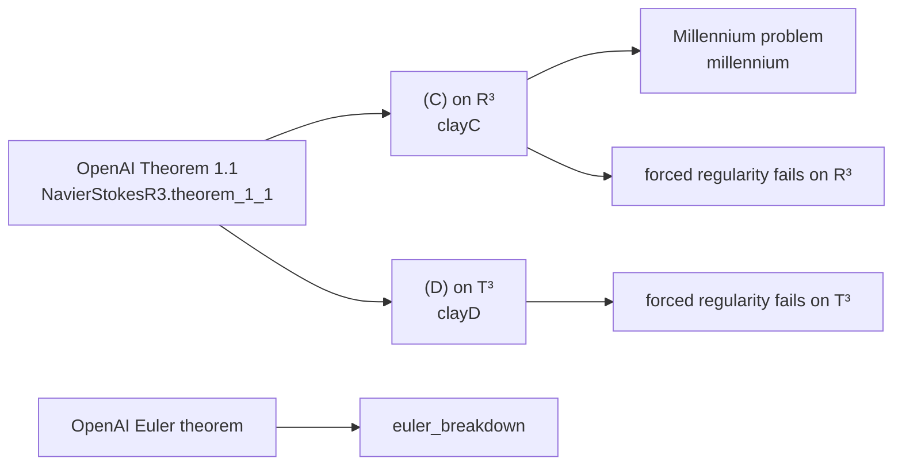

# Navier–Stokes closure


Lean 4 formalization accompanying the paper *Navier–Stokes Breakdown: A Readable Lean Closure*
by Deep Bhattacharjee.

The repository states the Navier–Stokes Millennium Prize problem of the Clay Mathematics Institute,
as formulated by C. Fefferman, as one Lean proposition: the four alternatives (A), (B), (C), (D)
and their disjunction. It proves the disjunction, and the corollaries below, from the formal proof of
finite-time blowup with a smooth force by OpenAI
([NavierStokesAndEuler](https://github.com/anaxia-research/NavierStokesAndEuler), commit `f9e8bc5`).



## Statements

| Lean declaration | Statement |
|---|---|
| `NavierStokesClosure.clayC` | Clay (C): for every viscosity, some smooth data and smooth force on R³ have no global smooth solution of bounded energy |
| `NavierStokesClosure.clayD` | Clay (D): the same on the torus R³/Z³, with periodic pressure |
| `NavierStokesClosure.clayC_and_clayD` | (C) and (D) together |
| `NavierStokesClosure.millennium` | (A) ∨ (B) ∨ (C) ∨ (D), for every viscosity |
| `NavierStokesClosure.not_forcedGlobalRegularityR3` | global regularity with a force fails on R³ |
| `NavierStokesClosure.not_forcedGlobalRegularityTorus` | global regularity with a force fails on the torus |
| `NavierStokesClosure.euler_breakdown` | unforced Euler breakdown from smooth compactly supported data |

The definitions of (A)–(D) are in `NavierStokesClosure/Clay.lean`. They use the reference
definitions of the Formal Conjectures project, which the OpenAI proof is checked against by Comparator.

## Build

```sh
lake exe cache get
lake build
lake env lean Verify.lean
```

`Verify.lean` prints the axioms of every declaration above; each depends only on
`propext`, `Classical.choice` and `Quot.sound`. The build compiles the OpenAI library
(about 430,000 lines of Navier–Stokes and 210,000 lines of Euler) and takes several hours on four cores.

## Julia checks

```sh
julia julia/scaling_checks.jl
```

checks numerically the viscosity scaling, the parabolic compression and the energy law used in
the reduction to the Clay statement. It needs no packages.

## Credits

The blowup construction and its formal proof are due to OpenAI. The reference statement is due to the
Formal Conjectures authors (Google DeepMind). See `NOTICE`.
